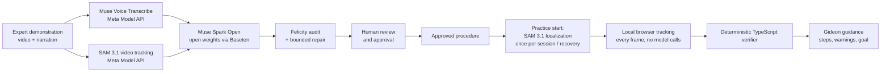
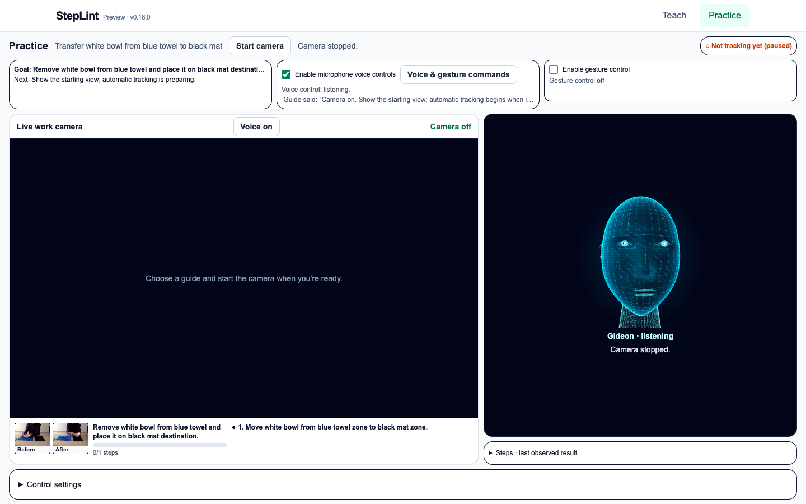
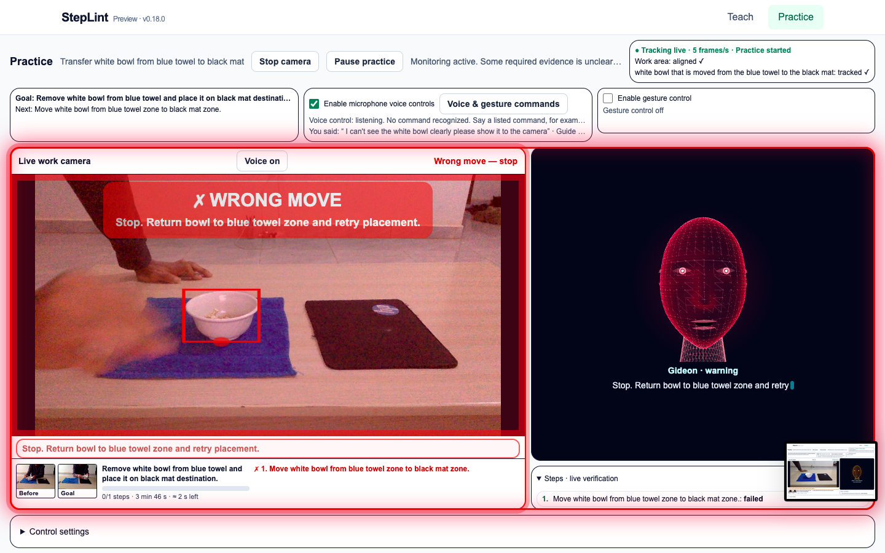
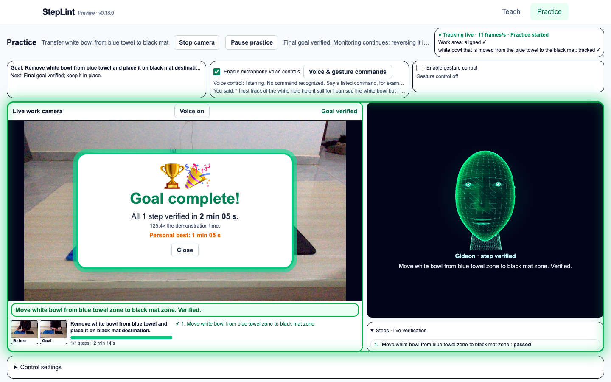
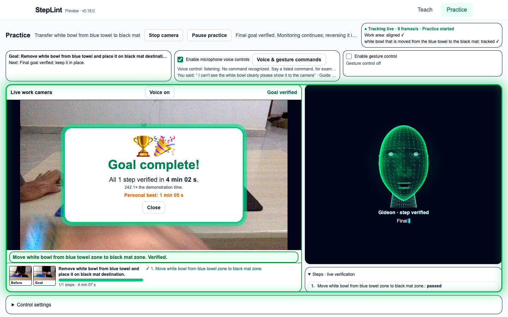
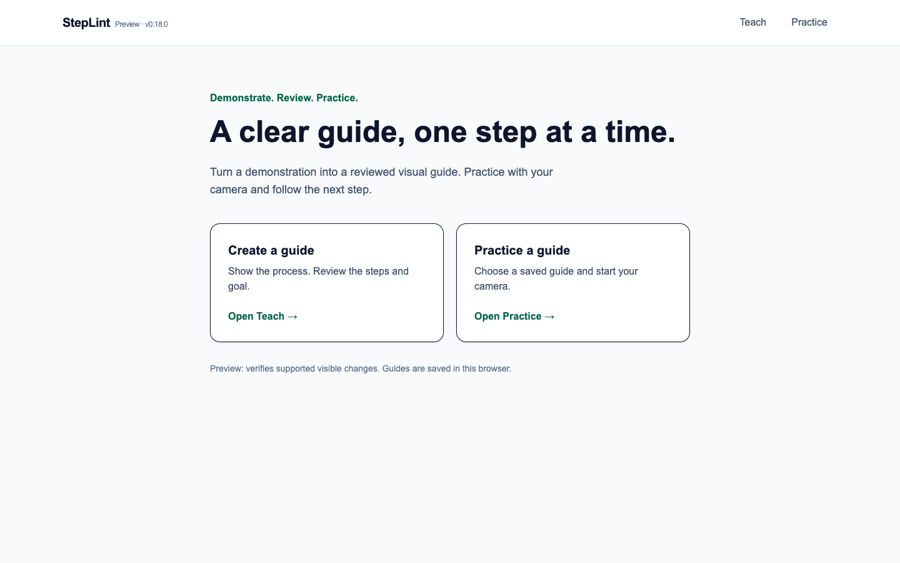

# StepLint

**Show a physical task once. StepLint turns it into a reviewed procedure, then watches a learner do it and checks each step against visual evidence.**

> Record → AI understands → Felicity checks and corrects → Approve → Practice tracks → Gideon coaches → Goal verified.

Built for the Meta Global AI Developer Hackathon. See [DEVELOPMENT_RECORD.md](DEVELOPMENT_RECORD.md) for what was built during the event.

## The problem

A written checklist can describe a step, but it cannot tell whether the step actually happened. People learning hands-on tasks (assembly, handling equipment, lab or kitchen routines) need someone watching who knows the procedure and notices a skipped, wrong or undone step. StepLint aims to be that watcher for simple, visible workbench tasks.

## How it works

1. **Teach (recorded).** An expert records a short demonstration and explains it out loud. StepLint transcribes the speech, tracks the objects through the video and drafts an ordered procedure. Every step carries its own start, change and result evidence.
2. **Felicity checks and corrects.** Felicity, StepLint's coordinating agent, audits the draft against the transcript and the measured movement of each object. When tracking is lost or a draft fails validation, she runs one bounded repair: she re-anchors the lost object for SAM, or rebuilds the steps from measured movement windows only. A repair is kept only if every deterministic validator accepts it.
3. **Human approval.** The expert reviews the steps, evidence and final goal, then approves with one action. Nothing reaches Practice without approval.
4. **Practice (live).** The learner opens the approved lesson and starts the camera.
   - **SAM 3.1 startup localization:** one bounded request finds the approved objects in the learner's own camera view, wherever the camera is placed. It runs again only when tracking needs recovery, never per frame.
   - **Local tracking:** after setup, objects are tracked frame by frame in the browser by a local worker, with no model calls.
   - **Deterministic verification:** a TypeScript verifier decides whether each step and the final goal were achieved, from measured positions, order and prerequisites. A completed step that is undone is invalidated and must be corrected.
5. **Gideon coaches.** Gideon is the learner-facing guide. He speaks the current instruction, warns, confirms verified steps and asks for a clearer view when evidence is uncertain.

**End-to-end result:** on 2026-11-04 the full workflow (record, Felicity checks and corrects, approve, Practice tracks, Gideon coaches, goal verified) ran successfully on the owner's own camera with real objects.

**Design rule:** models perceive and propose; deterministic code verifies. A model never decides that a physical step passed. Missing or ambiguous evidence means `needs_verification`, never an invented success or failure.



## Screenshots

Captured from the owner's own camera and real objects on 2026-11-04 (task: move the white bowl from the blue towel to the black mat).

| | |
| --- | --- |
|  |  |
| **Practice ready.** The approved lesson is loaded with its before/after references; Gideon is listening. | **Wrong move detected.** The tracker sees the bowl in the wrong place; the frame turns red and Gideon tells the learner exactly how to correct it. |
|  |  |
| **Goal verified.** The deterministic verifier passes the step; Gideon turns green and the goal is celebrated with the time taken. | **Corrected and verified.** After the wrong move, the learner returns the bowl and redoes the step; the goal is verified again, with total time and personal best. |



## Meta models and keys

| Model | Job in StepLint | Served by | Key |
| --- | --- | --- | --- |
| **Muse Voice Transcribe** (`muse-voice-transcribe-1.0`) | Timestamped transcript of the expert's narration | Meta Model API (`api.meta.ai`) | `MODEL_API_KEY` |
| **SAM 3.1** (`sam-3.1`) | Teach: tracks and outlines objects through the demonstration video. Practice: locates the approved objects in the learner's camera at startup and on recovery | Meta Model API (`api.meta.ai`) | `MODEL_API_KEY` |
| **Muse Spark Open** (`meta-models/muse-spark-open-1026`) | Finds task components, drafts the structured procedure, runs Felicity's audit and repair, writes Practice recovery advice | Baseten (`inference.baseten.co`), Meta's open-weight model | `BASETEN_API_KEY` |

The two keys go to two separate, server-only clients. `MODEL_API_KEY` is used only for SAM 3.1 and Muse Voice Transcribe; the Meta client refuses Muse Spark requests at its boundary. `BASETEN_API_KEY` is used only for Muse Spark Open. Neither key is ever sent to the browser. The OpenAI-named SDK is only an HTTP client pointed at these endpoints; no request goes to OpenAI.

In the browser console, `[practice] sam-3.1 (Meta API): … requests` and `[felicity] Muse Spark Open (Baseten): …` lines show each real model call. The `/api/practice/locate` response includes a `provenance` field naming the model and request count, with no keys.

## Quick start

**Requirements:** Node.js 22.12+ (22.x) or 24.x, npm, a desktop Chromium browser and a webcam.

```sh
git clone https://github.com/Lucky-Umoka/steplint-meta-hackathon.git
cd steplint-meta-hackathon
npm ci
cp .env.example .env.local
```

Fill in `.env.local` (server-side only, ignored by Git):

1. **`MODEL_API_KEY`:** create a key in your Meta developer dashboard ([getting started](https://dev.meta.ai/docs/overview)). It is used for SAM 3.1 and Muse Voice Transcribe.
2. **`BASETEN_API_KEY`:** create a key in your Baseten account with access to `meta-models/muse-spark-open-1026`. It is used for Muse Spark Open.
3. **`TEACH_ACCESS_TOKEN`:** a creator password you generate yourself (not from Meta or Baseten). It protects the paid Teach operations:
   ```sh
   node -e "console.log(require('node:crypto').randomBytes(32).toString('hex'))"
   ```

Run a production build (recommended; it is much faster for live tracking than the dev server):

```sh
npm run build
npm start
```

Open **http://localhost:3000/teach**, paste the same `TEACH_ACCESS_TOKEN` value into **Creator access code**, and record or upload a 10–60 second narrated demonstration. Review the draft and Felicity's notes, then click **Approve and practice**.

**Practising an already approved lesson:** open **http://localhost:3000/practice**, choose a saved lesson and start the camera. Learners need no keys or creator code. Lessons are stored in this browser (IndexedDB) for this origin.

Health check: `curl -i http://localhost:3000/api/health` returns HTTP 200 with `{"status":"ok","application":"steplint"}`.

## Tips for best results

- Place the camera on something fixed, pointing at the table, with every approved object fully in view.
- Start Practice with each object in its starting place, then work naturally; Gideon confirms each verified step.
- Use distinctive objects and even lighting.
- Run a production build (`npm run build && npm start`) and close browser DevTools device emulation while practising.

## Tests

| Command | What it checks |
| --- | --- |
| `npm run typecheck` | Strict TypeScript |
| `npm run lint` | ESLint |
| `npm test` | Unit and mocked-provider tests; no live model calls (`tests/setup-no-live.ts` blocks them) |
| `npm run build` | Production build |
| `npm run test:e2e` | Playwright browser tests with mocked providers and generated camera input |

Live model checks never run automatically. Each requires `--approved` and makes a bounded number of paid requests: `npm run smoke:spark`, `smoke:sam`, `smoke:sam-video`, `smoke:voice`, `smoke:baseten`. A successful smoke checks transport and output structure, not procedure accuracy.

## Repository map

- `src/app/teach`, `src/app/practice`: Teach and Practice user interfaces.
- `src/server/meta`: isolated provider clients (Meta Model API, Baseten).
- `src/server/teach`: Teach pipeline, Felicity audit (`audit.ts`) and repair (`repair.ts`, `felicity-repair.ts`).
- `src/server/practice`: SAM camera locate and Felicity recovery advice routes.
- `src/practice`: local tracking worker, live setup (`viewpoint.ts`), Felicity supervisor helpers.
- `src/procedure`: approved procedure contracts, deterministic verifier and final-goal gate.
- `tests`, `e2e`: unit, mocked-integration and browser tests.

## Further documentation

- [Architecture](docs/ARCHITECTURE.md) and [decisions](docs/DECISIONS.md)
- [Demo runbook](docs/DEMO.md)
- [Development record](DEVELOPMENT_RECORD.md)
- [Deployment](docs/DEPLOYMENT.md) · [Changelog](CHANGELOG.md)

The official SAM parser/model license is retained in `docs/licenses/SAM-LICENSE.txt`.
