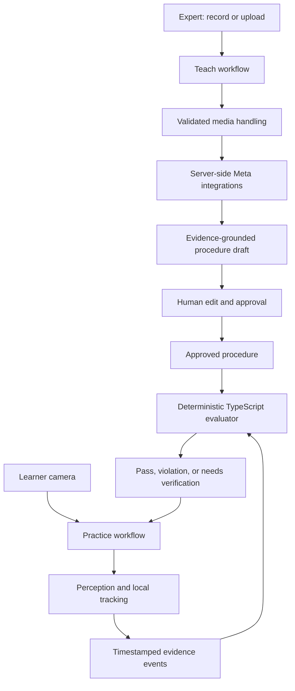

# StepLint architecture

**Status:** Phase 1 foundation is implemented; the two approved Spark/SAM smoke requests returned validated live results on 2026-10-29. Phase 2 now implements the pure procedure schema and verifier; the Teach/Practice UI and perception workflows below remain proposed. See [PHASE1.md](PHASE1.md) for verification evidence.

## System boundaries

Plan one TypeScript application using Next.js App Router, React, strict TypeScript, Node.js (Node 22 if verified compatible), npm, Route Handlers, Zod, and Vitest. Keep UI, media handling, provider clients, perception, procedure schema, and deterministic evaluation in separate testable modules. Do not add a second application stack or infrastructure without a demonstrated requirement.

## Teach-mode data flow

1. The expert records a short demonstration or selects a supported existing file, with consent, clear camera/microphone permissions, and visible recording state.
2. Media handling validates actual type, duration, and size, then uses only a verified encoding/upload path.
3. Verified Meta capabilities may transcribe speech, segment/track visual objects, and help interpret supplied evidence into a **draft** procedure.
4. Validate draft data with Zod. Show uncertainty and evidence references; do not infer actions solely from narration or object presence.
5. The expert edits and explicitly approves it. Practice mode must not consume unapproved drafts.

Teach is batch processing. It does not claim to detect mistakes while the expert is recording.

## Practice-mode data flow

1. Load a human-approved version of a procedure and establish the controlled scene.
2. Use supported perception to ground relevant objects; prefer local processing/simple tracking for frequent updates.
3. Convert observations into timestamped, typed evidence events, preserving source and uncertainty when available.
4. Feed those events to the deterministic evaluator, which checks preconditions, observable state transitions, order, and duplicates.
5. Present a supported violation and corrective step, a verified pass, or `needs_verification` when evidence is insufficient. Log the event and resulting evaluator state.

Do not send every camera frame to a paid API. Bound any model re-localization by need and measured budget.

## AI and deterministic verification

Planned Meta roles are distinct: Muse Spark for reasoning/structured interpretation of supplied evidence; Muse Voice Transcribe for speech-to-text; SAM 3.1 for object detection, segmentation, and video tracking. Their availability, request formats, and actual capabilities must be verified against current official docs before implementation.

AI may assist perception and draft generation, but the deterministic TypeScript evaluator is the source of truth for procedural pass/fail. Object detection is not action verification: seeing the red latch does not prove it is closed correctly, and seeing the yellow support does not prove it is seated. Require meaningful observable conditions, spatial relationships, and temporal evidence. Insufficient evidence stays unverified.

## Proposed procedure and evidence models

A procedure should carry ID/version, title/description, prerequisites, ordered steps, required objects, preconditions, expected states, advancement conditions, forbidden transitions, recovery instructions, references (timestamps/frame ranges where supported), and human review/approval status.

Evidence should include only meaningful available fields: observation ID, timestamp, object/track ID, position/bounding box/mask/target-zone relationship if provided or computed, evidence source, appropriately sourced/calculated confidence or uncertainty, and supporting frame/clip link when available. Keep raw model observations distinct from deterministic evaluated events.

Useful explicit states include `pending`, `in_progress`, `passed`, `failed`, `needs_verification`, and `blocked`. Duplicate events must not advance twice. Any manual override must be explicit and auditable, not represented as an automatic pass.

## Planned API routes

These are candidates from the project proposal, not existing endpoints:

- `GET /api/health`: safe availability check; no paid call and no environment disclosure.
- `POST /api/procedures/compile`: validate bounded input and create a draft through verified server-side provider code; validate the result, preserve uncertainty, and never approve it.
- `POST /api/perception/segment`: bounded perception request for supported input; validate the documented request/response and protect credentials.
- `POST /api/voice/transcribe`: supported transcription workflow with explicit media validation and safe errors.

Routes should remain small and delegate to testable modules. Do not implement a route until its provider contract is verified.

## Media and hosting

Begin with a short recording. Inspect the browser's real MIME type/codec, duration, and size, and verify compatibility with the chosen endpoint. Use upload-existing-video fallback if recording is incompatible. Mediabunny is only a candidate pending a compatibility spike. Check current Meta upload requirements and Vercel (or other selected host) request-body/execution limits before deciding between server proxy and secure direct upload. Do not proxy large files through a constrained serverless route.

## Security boundaries

Keep `MODEL_API_KEY` exclusively server-side; never expose it with `NEXT_PUBLIC_`, commit real `.env` files, log credentials, or return private environment configuration. Put provider code behind server-side modules. Validate and bound user input, media, and model responses. `.env.example` may use placeholders only; tests must not make paid calls by default.

## Testing strategy and open uncertainties

Use Vitest unit tests with mocked provider responses for schemas, event handling, evaluator order/transition/recovery, duplicates, invalid input, and ambiguous evidence. Keep explicitly invoked live smoke tests separate. Report mock tests, actual paid requests, manual browser checks, and unrun checks distinctly.

Unresolved until measured/documented: official model identifiers and API contract, SDK/package support and licenses, SAM parser API, media formats and upload flow, hosting limits, local tracking reliability, real-time latency, and model costs/quotas. See [docs/DECISIONS.md](DECISIONS.md) for status.

## Phase 1 foundation

Implemented paths: `src/app/` (minimal server-rendered page and GET health route), `src/server/meta/` (server-only client and response validators), `scripts/` (separate explicitly approved live requests), and `tests/` (local tests and a synthetic PNG). There are no model-calling HTTP routes. App rendering and health checks do not construct the Meta client. The official OpenAI SDK targets Meta's base URL; SAM output is consumed by the official parser. No Teach/Practice or media workflow is implemented.

## Phase 2 deterministic core

`src/procedure/schema.ts` defines strict Zod input/output schemas and inferred TypeScript types. `demo.ts` supplies the explicitly synthetic blue/yellow/red fixture. `verifier.ts` exposes `verifyEvents(unknown, unknown)`, validating and replaying a bounded event log into immutable-to-the-caller results. It has no server-only marker, I/O, provider, camera, or clock dependency; it can be tested in plain TypeScript independently of the app.

Observed target-zone changes, ordering, explicit forbidden rules, prerequisite preservation, uncertainty, duplicate protection, and reset/retry are implemented for the controlled fixture. There are still no procedure or segmentation HTTP routes. See [PHASE2.md](PHASE2.md) for semantics, source-time conventions, limitations, worked recovery, and test evidence.

## Phase 3 media compatibility spike

An isolated `/dev/media-lab` page now captures local media, probes browser codecs, converts compatible recordings with Mediabunny, inspects generated MP4/WAV bytes, and offers an existing-MP4 fallback. `src/media/` contains shared media inspection and browser conversion; `src/server/meta/media.ts` isolates the provider contracts; opt-in CLI scripts send bounded Files/SAM-video/ASR requests directly from Node. No paid web upload route, Teach workflow, or deployment has been added.

Local fake-device recording and PCM conversion were measured; the owner-provided recording subsequently passed approved live Files upload, SAM video parsing/decode, cleanup, and Voice transcription. See [PHASE3.md](PHASE3.md) for actual formats, latency, browser failures, limits, and manual gates. Vercel's documented 4.5 MB function payload limit is one reason to keep this experiment in CLI scripts instead of a large-file route proxy.
