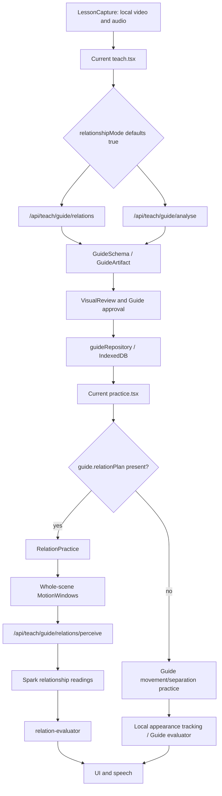
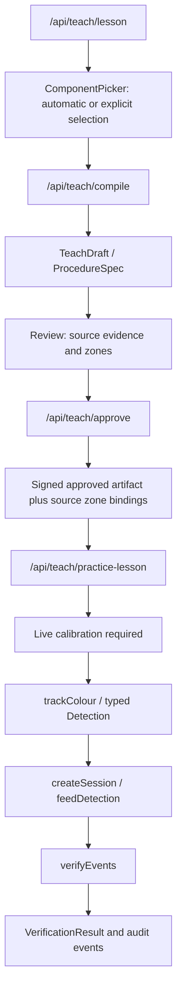
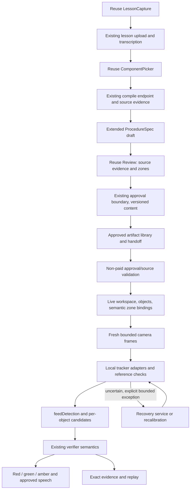

# Root-cause investigation and canonical local Practice integration plan

Date: 2026-11-01  
Inspected branch: phase/5-practice-mode  
Inspected HEAD: 40e566a — feat: fixed authoritative behaviour and latency  
Status: investigation and implementation plan; not an implementation or physical-acceptance claim.

## 1. Decision

Make the existing ProcedureSpec → local detections → feedDetection → verifyEvents architecture the canonical flow for newly authored lessons. Connect the actual Teach and Practice screens to it. Retire the relationship route from the normal verification critical path.

Do not create a third verifier, replace the UI wholesale, translate natural-language relationships into invented geometric proof, or merely increase the eight-second timeout. Keep legacy artifacts intact, with explicit capability limits and re-review for conversion.

The owner has confirmed first-delivery requirements: real objects exactly as they are, no stickers/substitute test pieces; continuous movements with no per-step buttons or artificial holds; and the separated measured latency targets in section 18. A marker-only demonstration cannot satisfy this delivery.

The existing zone implementation is reusable but is not a finished general-purpose replacement. This investigation found additional contract, timing, identity and authoring limitations that must be addressed within those existing modules.

A durable solution means an explicit supported scope, an executable approved contract, causal evidence, integration tests and physical acceptance. It cannot honestly mean a guarantee that no future bug or unsupported task will exist.

## 2. Scope of this turn and instruction precedence

The latest chat asks for investigation, an AGENTS.md rule and a detailed Markdown plan. That takes precedence over implementation commands embedded among the multiple prompts in NEW_ARCHITECTURE.MD. This turn does not switch production routes or spend Meta credits.

The document contains conflicting intermediate suggestions:

- A generic PracticeMode.tsx and /api/perceive are mentioned, but these are not the active application paths inspected.
- Some passages request 30+ FPS or sub-100-ms total verification; others correctly separate a 200–400-ms evidence dwell and a 600-ms total target.
- Some passages permit a controlled colour/marker proof; others question colour-only tracking.
- Some passages allow initial remote grounding; the final integration brief supports explicit local calibration.

This plan resolves these through the current code, the final integration brief and the open owner decisions below. It does not treat every pasted diagnosis as an established fact.

## 3. What the uploaded incident actually establishes

Private input: .media-lab/steplint-practice-diagnostics.json. Keep the original private and unchanged.

| Observation                                            | Meaning                                                                                                                                     |
| ------------------------------------------------------ | ------------------------------------------------------------------------------------------------------------------------------------------- |
| Method: visual-relations-v1                            | The failing session used RelationPractice, not the local zone pipeline.                                                                     |
| Camera active; 568 frames processed                    | Camera callbacks were functioning before the snapshot. This was not simply absent camera permission.                                        |
| Last frame interval 84 ms                              | Approximately 11.9 Hz for that last interval; this is not an average frame-rate measurement.                                                |
| Average callback processing 47.55 ms                   | Significant per-frame work; already greater than the 33.3-ms total frame budget at 30 FPS. It is not a latency p95.                         |
| Armed false; busy/locating false; queue empty          | The snapshot was paused, rather than actively evaluating a request.                                                                         |
| 11 requests remain                                     | Budget exhaustion does not explain this incident. Remaining quota does not prove an exact request count.                                    |
| Both lift-off-lid and place-on-plate waiting           | Neither declared action had been verified.                                                                                                  |
| Empty check history and evaluator events               | No completed authoritative action check was recorded. This is different from a completed model response deciding that an action was wrong.  |
| Zero tracks; notice says local circles unavailable     | No active tracks at export. However pause() clears tracks, so this snapshot alone cannot prove the initial tracker failure mechanism.       |
| Voice control off                                      | This export cannot establish a voice-recognition failure. Spoken guidance and voice commands are separate settings.                         |
| No explicit pause reason or window timestamps exported | The reported timeout must be correlated with the owner’s quoted message and the code; it cannot be reconstructed completely from this JSON. |

The diagnosis must preserve those distinctions. Do not blame the clip, Mac, browser, model service, budget or operator without evidence.

### Why the same bottle instruction remains

The UI chooses the first step whose state is not verified. In this session both steps remained waiting, so the first lift instruction remained active. The string is data from the saved plan; a source search found no production hardcoding of “red squeeze bottle” or “lift-off-lid”.

The export does not include the full approved goal, source transcript, step conditions or reviewer decisions. The owner subsequently confirmed that the intended action is one continuous move from the blue lid onto the white plate. A separately held lift checkpoint is therefore a task-definition error for this lesson, not a requirement the learner should repeat.

The planner already contains prose telling it not to invent a mid-air hold for a continuous transfer. That instruction is not a structural executable guarantee. More prompt wording alone will not fix that contract.

## 4. Current architecture: actual call graph



A separate existing path is present:



The second diagram describes reusable modules and the intended connection, not a working current screen flow. The missing links are main-UI orchestration, persistence/import, live calibration, the frame-to-pipeline adapter and the result-to-UI/evidence adapter.

### Twelve requested trace answers

| Question                                           | Current-code answer and evidence                                                                                                                                                                                                                                                                                                                                                       |
| -------------------------------------------------- | -------------------------------------------------------------------------------------------------------------------------------------------------------------------------------------------------------------------------------------------------------------------------------------------------------------------------------------------------------------------------------------- |
| Which route handles relationPlan?                  | src/app/practice/practice.tsx:1290 branches to RelationPractice.                                                                                                                                                                                                                                                                                                                       |
| Remote interpretation per candidate?               | Yes. RelationPractice.check posts three observations to /api/teach/guide/relations/perceive. src/server/guide/relation-perception.ts calls inspectRelationEvidence; src/server/guide/relations.ts uses muse-spark-1.3.                                                                                                                                                                 |
| Standard Guide route local?                        | Yes. practice.tsx uses appearance tracking and feedGuideObservation. Remote grounding/recovery also exists.                                                                                                                                                                                                                                                                            |
| Does standard Guide movement define a destination? | No. guide/evaluator.ts:changeMetric measures normalized displacement or increased separation. ConditionSchema has no fromZone/toZone. Do not make this route the “fast” destination verifier.                                                                                                                                                                                          |
| What activates the first relation step?            | An approved Guide is selected, a session is opened, camera starts, initial locate is attempted, capture is seeded and running is armed. A failed local highlight setup can still leave whole-scene remote checking enabled. The standard Guide route separately requires a clear aligned starting phase/baseline and Ready or an observed automatic-start candidate before beginGuide. |
| What produces red?                                 | A supported wrong relation or wrong order in relation-evaluator emits violation. Missing/ambiguous evidence should stay needs_verification. A separate local placement warning is advisory.                                                                                                                                                                                            |
| What renders red?                                  | RelationPractice uses the failed step, correction banner and practice-correction-pulse. Existing PracticeAlert can be reused by the canonical path.                                                                                                                                                                                                                                    |
| What speaks correction?                            | check() selects emitted violation guidance and calls say(), which dispatches SpeechSynthesis. No emitted event means no authoritative correction to speak.                                                                                                                                                                                                                             |
| What blocks frame work?                            | Camera lifecycle/visibility/stall conditions; inactive or finished session; grounding; paused running flag; request/queue/backpressure gates. Camera callbacks continuing does not imply evaluator observations are being produced.                                                                                                                                                    |
| Normal network calls?                              | Session validation; starting object perception; repeated relationship perception per captured candidate in the relation path. It does not send every camera frame to SAM.                                                                                                                                                                                                              |
| What are generated-camera tests proving?           | Many current browser checks seed Guide fixtures and mock perception; the added worker check runs real local MediaPipe on generated frames. Zone integration is primarily tested below the actual UI. None proves this physical session.                                                                                                                                                |
| Physical Teach-to-Practice accepted?               | No. The owner’s physical failure remains the latest acceptance result. Prior paid source-video replay passes do not change that result.                                                                                                                                                                                                                                                |

## 5. Confirmed root causes and causal chains

### R1 — The stronger contract is disconnected from the product

Main Teach imports Guide schemas, VisualReview and guideRepository; relationshipMode starts true. It does not compose ComponentPicker and Review.

Main Practice imports saved Guide records. A source search finds no production UI caller of createSession/feedDetection. The sessionStorage key steplint-approved-handoff is written by the older Review, but the current Practice UI does not consume it. The non-paid practice-lesson approval endpoint is exercised by tests rather than the normal UI.

Why this repeats: improvements to a standalone verifier cannot improve a screen that never calls it. Historical documentation describes both architectures and has sometimes presented obsolete routing as current.

Repair: one canonical new ProcedureSpec authoring/import/calibration/runtime path, tested through /teach and /practice.

### R2 — Semantic interpretation remains on the decision path

The relation route must gather a whole-scene motion window and then wait for a network request and Spark’s readings before its deterministic evaluator can decide. The collector waits at least 400 ms after motion and then another 400 ms between result samples before issuing a normal check. Continuing hand/background motion can keep resetting that collection. A live camera therefore does not imply continuous per-frame rule evaluation, and the pre-request settling period alone exceeds a 600-ms total goal in the ideal case. Local moving circles are not inputs establishing the authoritative relationship.

Why this repeats: optimizing masks, overlays, speech or UI rendering leaves the dominant observation dependency unchanged. Replacing the call with an unvalidated bounding-box overlap would create a fast false pass.

Repair: compile only genuinely measurable local predicates into the approved spec. Remote perception becomes explicit, bounded exception handling rather than a required step in each normal action.

### R3 — The eight-second bound conflates action duration, idle time and evidence freshness

MotionWindows refreshes a quiet baseline only when baseline difference is less than 1. It starts motion for larger thresholds. Intermediate drift can preserve an old baseline without starting an action. Later it rejects last.frame minus baseline.frame greater than 8000.

Offline reproduction with the actual class:

1. Seed baseline at 0 ms.
2. Supply small non-triggering spatial drift for 10 seconds.
3. Begin actual motion at 10100 ms.
4. Supply settled results at 10500 and 10900 ms.
5. The eight-second exception occurs although the simulated movement/result interval is only 800 ms.

This is a synthetic algorithm reproduction, not proof that this exact drift occurred in the owner’s camera. It demonstrates why the message is not evidence that the user moved for eight seconds.

Repair: normal zone verification uses independent per-object states, actual observation freshness and stable target entry. It has no whole-scene eight-second action window. Keep bounded image buffers separate from logical event history. A slow but continuously observed valid transfer must not lose its start solely because it takes a few seconds.

### R4 — The approved task may be semantically incomplete or over-split

A goal sentence or result image does not specify the measured reference point, destination, forbidden region, prerequisite timing or tolerances. A generated lift checkpoint can be impossible to satisfy naturally while performing a continuous transfer.

Repair: an explicit goal/coverage ledger and per-step measurement plan, including capability status and before/change/result evidence. One continuous placement stays one action unless a genuine intermediate checkpoint is required and observable. The owner has explicitly rejected a separate lift checkpoint in the bottle lesson; continuous movement must be preserved through slow travel, changing speed and harmless pauses without requiring an invented mid-air pose. Do not silently delete necessary actions to simplify the demo.

### R5 — Identity and calibration are not guaranteed by “local tracking”

An outline score is not identity accuracy. Current colour segmentation supports distinctive saturated parts; feature tracking has texture, occlusion, rotation and search limits. Source-video coordinates do not automatically map onto another camera.

Repair: explicit live workspace calibration; typed tracker capability/quality; monitored reference identity; uncertainty rather than invented continuity; signed semantic rules separated from camera-local geometry.

### R6 — The previous validation did not cover the real integration and incident

Pure verifier tests, empty local-track mocks and replays of the training recording do not establish correct source meaning, independent learner perception, physical latency or that the zone UI path is connected.

Repair: application-level contract tests, held-out observations and owner-device physical acceptance. Preserve original failed incidents and declare which failure each regression addresses.

## 6. Existing zone code: reuse and hardening audit

| Existing capability                          | Reuse                                                                          | Important limitation to resolve                                                                                                                                                                                     |
| -------------------------------------------- | ------------------------------------------------------------------------------ | ------------------------------------------------------------------------------------------------------------------------------------------------------------------------------------------------------------------- |
| ProcedureSpec and verifyEvents               | Rules, prerequisites, duplicate rejection, order, uncertainty and audit events | schema.ts enforces one step per component; verifier.ts uses findIndex by component. Merely removing the schema check would still dispatch repeated-object actions incorrectly.                                      |
| fromZone/toZone                              | Explicit approved destination                                                  | Measures a component centre entering a 2D region; not contact, secure installation, containment, torque or electrical correctness.                                                                                  |
| feedDetection                                | Fresh-frame debounce, typed detections, 400-ms dwell                           | Visible transit outside zones is preserved only for 1.2 seconds. A separate synthetic probe shows a continuously visible slow transfer becomes ambiguous and cannot pass.                                           |
| validateSetup                                | Required IDs and per-condition start/target overlap checks                     | Does not establish physical identity, camera stability, all relevant-zone overlap ambiguity or semantic correctness of learner mappings.                                                                            |
| Forbidden rules                              | Premature approved transition until earlier prerequisites verified             | Current Teach validation requires the forbidden condition to copy the owning transition. It cannot represent an arbitrary forbidden destination or unconditional first-step prohibition.                            |
| verifyEvents recovery                        | Fresh reopen/return and correct subsequent transition can recover              | Pure recovery tests exist, but pipeline recovery tests also use manual retry. Add a real UI regression that recovers solely from fresh physical observations.                                                       |
| Passed-state invalidation                    | Loss of a required target invalidates dependent steps                          | “All historical destinations remain occupied” is unsuitable for legitimate later moves of the same object. Explicit final-goal conditions are needed.                                                               |
| Full-log replay                              | Deterministic reference implementation and provenance                          | feedDetection revalidates/replays the entire growing log on emitted observations. Repeated stationary observations and a 9500-event stop limit need a measured lifecycle/performance policy.                        |
| Timestamping                                 | Strict sequence and duplicate rejection                                        | Same-frame component observations are assigned artificial increasing milliseconds. Preserve real frame time and use explicit sequence/frame IDs, rather than implying physical order from processing order.         |
| Draft/review evidence                        | Source IDs, tracked frames, explicit reviewer and zone evidence                | One-to-four selections/steps, confidence and continuous source-evidence gates, and no explicit coverage/capability/goal contract. Missing source evidence still blocks authoring.                                   |
| Approved export and practice-lesson endpoint | Integrity receipt, source identity and non-paid validation                     | Receipt hashes JSON serialization and is bound to approving session. A long receipt expiry does not remove the shorter owner-cookie/session limitation. Parsing/reordering must not silently alter signed contents. |
| Colour tracker                               | Existing local, bounded, distinctive-marker detector                           | Requires saturated distinguishable colours; white/grey plates, repeated colours and reflective parts are not generic supported inputs. It accepts at most 320×240 pixels.                                           |
| Appearance tracker                           | Existing feature/mask machinery for a second adapter                           | Its score/provenance and null-score overlay output do not automatically satisfy the zone Detection quality contract. Do not invent 0.99 confidence to bridge the types.                                             |

The 139 selected existing procedure, Practice, Teach and motion-window tests passed during this investigation. The edge probes above still reproduced the limitations. Passing the existing tests therefore does not close the architecture gap.

## 7. FIFA reference: what to borrow

FIFA describes frequent player/ball observations, a precise event time, defined positional rules, official review and a replay generated from the same decision data. Its current explanation also describes pitch-calibration data. This is the relevant engineering reference, not a promise that a single webcam has equivalent sensing or latency. [FIFA technical explanation](https://inside.fifa.com/innovation/innovating-the-game/semi-automated-offside-technology)

| Borrowed principle  | StepLint design implication                                                   |
| ------------------- | ----------------------------------------------------------------------------- |
| Known field         | Camera-specific workspace calibration and monitored references.               |
| Known targets       | Stable approved identities and the smallest sufficient watch set.             |
| Defined event       | Per-object origin, transit, stable target and explicit forbidden transitions. |
| Rules before play   | Human-approved executable conditions, not post-hoc interpretation.            |
| Reviewable evidence | Immutable decision events linked to actual measured observations.             |
| Same-data replay    | Render the positions/frames used by the evaluator; no AI retelling.           |

FIFA’s description of fast tracking does not imply all reviewed decisions take less than a millisecond. Its 2022 explanation explicitly distinguishes automated detection from officials’ subsequent review. [FIFA 2022 explanation](https://inside.fifa.com/innovation/media-releases/semi-automated-offside-technology-to-be-used-at-fifa-world-cup-2022-tm)

## 8. Canonical target architecture



Normal supported action decisions have no Spark/SAM dependency. Source creation may still use the existing server-side Meta integrations. Approval validation is an HTTP security boundary, not a paid model call.

Initial local calibration is preferred for the controlled proof. Remote recovery is optional and independently bounded; it must not auto-renew budgets, block capture, silently assert identity or restore a missing action history.

The existing ProcedureSpec is the canonical semantic contract. A live calibration supplies geometry for its approved zone IDs; it does not rewrite prerequisites, destinations, evidence policy or approval.

## 9. Executable contract: extend existing schemas, do not add another engine

“ExecutableStepSpec” means an evolution of the existing StepSchema, not a parallel application architecture.

A versioned new format should include:

- Explicit whole-procedure goal, required history and final conditions.
- Coverage of every necessary demonstrated requirement: included, unsupported or outside the agreed goal, with reviewed reasons.
- Stable component and anchor/reference IDs.
- Existing ordered prerequisites and approved correction/recovery.
- Explicit origin/target zones and supported measurement method.
- The tracked reference point on the unmodified object: selected feature, measured object centre or another implemented, validated reference.
- Entry/exit margins, units, minimum fresh frames, stable dwell and maximum observation gap.
- Required visible identities, scene/calibration epoch and tracker capability.
- Before/change/result source frames and exact source times.
- Explicit forbidden destinations/transitions only where approved.
- Automatic-Practice support status and a reason when unsupported.

Illustrative addition to the existing contract, not implemented code:

```ts
type LocalStepMeasurement = {
  method: "zone_transition";
  componentId: string;
  fromZone: string;
  toZone: string;
  trackedPoint: "approved_feature" | "observed_object_center";
  minimumFreshFrames: number;
  stableForMs: number;
  maxObservationGapMs: number;
  entryMarginNormalized: number;
};

type ExplicitGoal = {
  requiredStepIds: string[];
  finalConditions: Array<{
    componentId: string;
    zoneId: string;
    stableForMs: number;
  }>;
};
```

Keep schema format version separate from procedure revision. Parse legacy signed artifacts through their original contract. New fields and semantic changes require a new draft and explicit human approval; never attach them to an old approved signature.

### Repeated-object tasks

Maintain component identity separately from step identity. Resolve a component observation against its eligible/forbidden step conditions and action history, not the first component match. A later legal move must not invalidate an intermediate destination that is no longer a required final condition.

This is required before claiming general multi-step object manipulation. The first distinct-component proof does not establish it.

### Goal correctness

Completion requires:

1. Every required historical transition observed in approved order.
2. No unresolved failed prerequisite.
3. Current fresh evidence for every final condition.
4. A valid calibration epoch and required identities.
5. No unsupported required requirement hidden in notes.

An already-arranged final scene cannot manufacture history. A bottle merely lifted from a lid cannot satisfy a placement destination.

## 10. Supported measurements and honest boundaries

Initial local automatic support is image-zone transition verification on a fixed calibrated workspace.

| Requirement                                            | Treatment                                                                                                                                      |
| ------------------------------------------------------ | ---------------------------------------------------------------------------------------------------------------------------------------------- |
| Approved tracked point enters a target region          | Locally measurable with identity, freshness, calibration and dwell checks.                                                                     |
| Wrong order of that supported transition               | Deterministic violation with the exact missing prerequisite.                                                                                   |
| Entry into an approved forbidden region                | Add explicit supported rule; do not invent red failures for every unrelated position.                                                          |
| Stable movement to an unapproved region                | Target not achieved / amber unless a specific approved prohibition makes it a violation.                                                       |
| Geometric separation or relative position              | Enable only after defining the actual points, reference frame, units and independent test evidence.                                            |
| Physical support/contact, containment, closure         | Not proven by mere box overlap or centre occupancy. Keep unsupported until a concrete observation adapter can establish the claimed condition. |
| Hidden force, torque, temperature, safe hardware state | Outside the present camera-only capability.                                                                                                    |

A static drawn region is not the same thing as a moving plate. A destination attached to a movable object needs that reference tracked or a declared, enforceable fixed-reference arrangement. Drawing a region over an empty place must not silently count as proving a bottle is on a plate.

## 11. Teach integration and review plan

Reuse:

- LessonCapture for bounded media and lifecycle.
- /api/teach/lesson for confirmed upload/transcription and encrypted reference.
- ComponentPicker for automatic discovery or explicit source marks.
- /api/teach/compile for the actual NDJSON progress/draft/context/token contract.
- Review for source imagery, starting/target regions and explicit approval.
- /api/teach/approve for authenticated evidence validation and receipt issuance.

Required integration changes:

1. Replace the Guide-default orchestration for new lessons with the existing ProcedureSpec pipeline.
2. Preserve the retained local video, actual decoded source timeline and all returned context through review.
3. Reconcile draft requirements with the intended full goal before declaring the lesson executable.
4. Show one compact card per step: identity, start, change, result, actual measurement, pass/violation criteria, prerequisites, correction and capability.
5. Reuse source frame/zone editors; reset affected review approvals after structural edits.
6. Block full automatic approval if any required step is unsupported. Preserve the useful partial draft and explain what cannot be measured.
7. Save the exact approved artifact and receipt, then hand off into the real Practice UI.

Do not merely reconnect an old compiler prompt that silently narrows an unboxing/repair goal into a small movement. Source-quality failures from historical logs remain a real blocker. Do not lower the existing source confidence/continuity gates to achieve an apparent integration pass.

The creator’s goal is not inferred solely from the last frame. Continuous transfer grouping and necessary intermediate checkpoints must be explicitly reviewed.

## 12. Persistence, approval and compatibility

Extend the existing storage/handoff boundary with a tagged ProcedureSpec artifact alongside preserved legacy records. This is format compatibility, not an ordinary-user engine selector.

- Consume and validate the existing steplint-approved-handoff.
- Persist the original approved payload/receipt without serializer-induced changes.
- Revalidate through /api/teach/practice-lesson before calibration or execution.
- Keep source zone geometry distinct from live learner bindings.
- Bind live calibration to procedure digest, camera epoch and semantic zone IDs.
- Never change approved logical rules through calibration.
- Keep source-reference thumbnails/media hashes associated with their real source frames, with appropriate local-storage consent.
- Test altered artifact, receipt, source identity and expired session failures.

The existing receipt is scoped to the approving owner session. For the first controlled proof, preserve and disclose that restriction. Before claiming durable cross-session authoring, define a versioned workspace-owner authorization design that separates durable approval identity from the short-lived login cookie. Existing signatures must keep their original scope; do not remove authentication or silently migrate approval.

Legacy Guide lessons should remain identifiable, readable/exportable and rebuildable with review. They must not be advertised as equivalent local destination-verification procedures. Do not silently rewrite their rules or delete the owner’s library.

## 13. Live calibration contract

One-time setup, followed by automatic operation:

1. Select an approved procedure and validate its signed payload.
2. Start the actual camera and fix its position.
3. Establish current image orientation, workspace boundary/reference points and intrinsic pixel dimensions.
4. Map approved semantic zone IDs onto the actual learner view.
5. Identify each required component and reference using a supported tracker.
6. Reject missing, ambiguous or overlapping relevant mappings.
7. Confirm observable initial conditions and readiness automatically once setup is valid.
8. Lock the calibration epoch and begin evaluation without an extra per-step Ready/Check.

Calibration must preserve pixel/video coordinates through CSS zoom, resizing and mirroring. Recompute display transforms separately from measurement coordinates.

Use normalized image coordinates for the initial fixed-camera proof. Add a planar homography only if perspective tests demonstrate it is needed. A planar transform does not establish object height or contact.

Monitor camera/reference change independently of active object movement. If alignment is unknown or changes beyond the supported tolerance, mark evidence unavailable, suspend decisions and require recalibration. Do not depend on finding texture in an arbitrary plain table: use explicitly selected stable features already present in the real workspace. Do not add physical markers as a first-delivery dependency.

An operator’s live mapping is a human-supplied semantic assertion. Record its confirmation; do not claim automatic identity/target calibration if it was manually supplied. Moving references need ongoing checks.

## 14. Tracking plan and colour question

Separate the evaluator’s Detection interface from the visual acquisition strategy.

### Required first delivery: real objects without alteration

The owner has rejected added stickers and substitute coloured test pieces for the first delivery. Validate the actual objects in the supplied videos, starting with the bottle, blue lid and white plate. Naturally occurring colour may help identify a real object, but it must not be the only supported identity signal or require replacing that object.

Use the existing local appearance/foreground machinery as the first adapter candidate for unmarked objects. Combine only available measured cues: distinctive features/texture, edges or silhouette where the current implementation genuinely supports them, existing appearance/colour information, temporal correspondence and live calibration. Do not claim that every such cue is already implemented.

Define a quality-preserving adapter into the same zone Detection interface. The detector can change; the approved zone rules and deterministic verifier remain canonical. A null overlay score cannot be converted into a fabricated 0.99 confidence. Reject competing identities, clipping, lost correspondence and unsupported visual conditions.

Required validation includes the real target/reference objects, not only the moving bottle. A white plate is not supported by the saturated-colour tracker alone. Its actual boundary/appearance or a reviewed fixed-reference arrangement must be validated; an arbitrary screen region cannot stand in for an unobserved movable plate.

Use labelled held-out observations from the supplied footage and an independent physical-camera run. Include changing speed, natural hand overlap, similar background colours, view changes and wrong destinations. If the existing tracker cannot support these real inputs, that is a first-delivery blocker to report and solve, not permission to substitute stickers, fixtures or a slower normal remote-check route.

The existing colour tracker and blue/yellow/red fixture remain useful for unit tests and comparative benchmarks. They are not physical acceptance evidence for this requirement. No OpenCV dependency, new provider or new tracking framework is assumed by this plan.

### Watch set

Track the current operation, required persistent goal/prerequisite references, and components whose premature transition could violate the procedure. Tracking only the active component cannot detect an early future latch action.

Use a bounded component count and shared frame preprocessing. Capture the bounded tracking surface directly; reading a 640×480 canvas and then resampling it to 320×240 still pays the larger readback cost. Schema limits of 100 components do not demonstrate that 100 objects can be tracked at the target rate. Start with the real-object scope demonstrated in the supplied clips, including the necessary destination/reference identities. The synthetic three-component case remains a regression fixture.

## 15. Local runtime, timing and recovery

Reuse use-guide-camera lifecycle with a bounded frame provider into the canonical Practice component. Avoid overlapping processing and unbounded frame queues.

For each fresh frame:

1. Validate calibration epoch and observation freshness.
2. Track required identities.
3. Produce raw measured detections, including uncertainty.
4. Update per-object origin/transit/target candidates and any approved approach-to-forbidden-condition guards.
5. Confirm only the approved stability policy.
6. Feed accepted observations into the existing verifier semantics.
7. Emit one immutable decision event.
8. Render its visual state independently of speech.
9. Dispatch the approved correction/next instruction once per event ID.
10. Attach the exact evidence references.

Visible transit must remain distinct from missing identity. A continuously observed move may be slow. A lost or ambiguous track must not retain a fictional path or regain a pass simply by appearing in the target.

### Continuous movement must not wait for software confirmation

Track and measure throughout motion. Do not wait for whole-scene quiet, ask for a mid-air pose, or impose a pause at each step. A naturally stationary placed object can accumulate confirmation evidence while the learner already reaches for the next object.

Separate three times on every candidate: when the condition was physically observed to occur (with a frame-bounded uncertainty interval), when sufficient evidence confirmed it, and when feedback was dispatched. Existing code uses verification timestamps for chronology; preserving that unchanged would falsely reject some continuously performed, physically correct sequences.

Example: the base enters its target at 100 ms; the support starts moving at 250 ms; sensor confirmation of the base finishes at 500 ms. If the approved requirement is that the base be in place before support movement, the software must not call this wrong order solely because its confirmation arrived later. Retain both candidates and compare actual observed event intervals once evidence is sufficient. Do not backdate an unobserved event or accept ambiguous overlapping intervals.

A true physical dwell requirement is different from a sensor-confirmation dwell. Represent that distinction in the versioned rule. If a procedure genuinely requires a physical hold before the next action, enforce it. If dwell exists only to reject measurement noise, it must not create an extra learner action or mandatory pause.

Use bounded per-object candidate buffering within the existing pipeline and reducer. Append confirmation/decision records with their observed-event references; do not erase or rewrite history. Preserve stricter legacy semantics under their original approved format. New timing semantics require reviewed versioned rules and replay-equivalence tests for that format.

### Early correction while moving

Define an optional approved motion guard for a measurable forbidden region/transition: tracked object/reference, geometry, prerequisite, approach margin, evidence quality and warning policy. Evaluate it on fresh local observations while the learner is moving.

- Show an amber early warning when a clear measured approach or short-horizon trajectory indicates a possible entry into a forbidden condition. The wording should identify the relevant prerequisite or region, not claim to know the learner's intention.
- A simple short-horizon trajectory may use several fresh, directly observed positions and timestamps. Bound its uncertainty and horizon; disable predictive guidance when tracking or direction is unreliable.
- Show red only when the approved violation predicate has sufficient actual evidence. Predicted coordinates never count as observations, completed steps or a confirmed failure.
- Treat a forbidden boundary crossing and a required stable placement as different event definitions. A crossing can occur during continuous movement; it must not require the person to stop in the forbidden region just to be detected. Each rule needs a justified confirmation policy, not a blanket reduction of existing stability safeguards.
- Dispatch the approved stop/correction guidance independently of browser speech playback and maintain visual feedback even when speech is unavailable.

An endpoint restriction is not automatically a forbidden path. Moving over a surface en route may be legitimate even when leaving the object on that surface would be wrong. Do not turn ordinary continuous transit into repeated stop warnings; the approved rule and the warning's measured reliability must justify the intervention.

No camera-only system here can guarantee prediction of every wrong move, prevention of damage, or that a learner physically stops in time. The release tests must measure warning lead time and actual misses/false alarms rather than promising interception.

Automatic recovery uses fresh return/reopen evidence and a new correct transition after the missing prerequisite. Preserve the original failed event. A retry button, speech command or gesture cannot mark recovery or advance a step.

Remote recovery, if later enabled, is opt-in/bounded and applies only to identity uncertainty. Its result cannot supply unobserved action history or rewrite the approved rules. Keep local capture and unaffected valid measurements running.

### Reversal after a verified step: continuing obligations

The owner explicitly requires correction when a learner starts undoing a verified step. A green event is historical evidence, not permission to stop observing a required current state.

Extend the existing per-step contract with an approved persistence/reversal policy:

- Which measured postcondition must remain true.
- How long it must persist: through completion, until an authorized later action starts, or another explicitly valid release condition.
- Which reverse/exit transition is forbidden and which later movements are legitimate.
- Entry/exit margins and evidence quality needed to avoid boundary jitter alarms.
- Approved early warning, confirmed reversal correction and recovery predicate.
- Which downstream conditions must be invalidated or revalidated after loss.

Reject contradictory specifications. For example, do not require an object to remain in an old zone until a later move is fully verified when that later move necessarily requires leaving it. Define the authorized release point explicitly.

While the camera session is active:

1. Keep a small local watch set for verified conditions that still have persistence obligations.
2. If a reliable measured trajectory approaches a forbidden exit/reversal, provide a provisional amber cue and approved guidance. Do not change historical pass status on prediction alone.
3. If fresh observations confirm an unauthorized reversal, emit a new red violation event naming the affected step and its approved correction. The current required state is invalid; dependent progress is blocked or requires revalidation.
4. If the object becomes missing or obscured, use amber needs_verification; disappearance is not evidence that the user reversed it.
5. Preserve the original pass and the subsequent reversal in the immutable audit timeline. Do not erase the mistake, increment completion twice or overwrite the history to appear successful.
6. Observe the approved recovery automatically. A simple bottle-placement recovery may restore the plate position, whereas another procedure may require returning to the origin and repeating the transition or redoing affected dependencies. The creator's reviewed rule decides; do not generate unsafe generic “reverse back” instructions at runtime.
7. Emit a distinct restoration/revalidation event when that recovery is supported. Re-establishing a current postcondition must not be misrepresented as a newly observed original action.
8. Release monitoring of an old intermediate state only when the approved later action legitimately permits it; returning a tool as instructed is not an unauthorized undo.

This also applies after the first goal-achieved indication if the camera session remains active. The current relation route exits evaluation when session.finished is true; the canonical path must not silently stop monitoring persistent goal conditions behind an active camera. Show that monitoring continues until Stop. An undo changes the current goal/run status and updates the same session record while preserving the earlier goal-achieved event. Stopping the session closes that monitoring obligation; no monitoring after camera shutdown is claimed.

## 16. Verifier and timestamp performance

Keep verifyEvents as the deterministic replay reference. Measure replay cost at realistic log sizes.

The offline benchmark below shows full replay alone exceeding the post-evidence budget at a larger log. For sustained low latency, factor its existing transition semantics into an internal reducer used by both replay and incremental session processing. This stays within src/procedure/verifier.ts and src/practice/pipeline.ts; it is not a competing verifier.

Required proof: for every tested log prefix, incremental state and decisions equal full replay, including duplicate/conflicting IDs, stale input, invalidations, forbidden order and recovery.

Do not revalidate the entire immutable approved procedure or replay thousands of unchanged events on every frame. Do not silently discard historical failed events to reduce cost.

Preserve real frame IDs and observation times. Process same-frame component detections as a coherent snapshot; use explicit sequence IDs for deterministic ordering rather than fabricating physical milliseconds. Frame gaps, not long valid action duration, govern freshness invalidation.

Bound image memory separately from semantic events. A bounded log must offer a deliberate export/new-session lifecycle before overflow, not freeze a supposedly active session.

## 17. UI, speech and replay

Reuse the camera area, step list, PracticeAlert and approved speech adapters.

Normal controls: start, pause/resume, stop, repeat instruction, recalibrate. No ordinary Check button. Keep model names, thresholds, API details and budgets in optional diagnostics.

- Red: confirmed violation, exact step/prerequisite, approved recovery instruction.
- Green: supported verified transition; advance automatically.
- Amber: ambiguous observation, missing identity, incomplete calibration or an unconfirmed candidate.
- Early amber may precede a confirmed red result; do not flash a definitive failure before sufficient evidence.

Deduplicate visuals, timeline entries and speech by decision ID. Do not repeatedly cancel and respeak unchanged guidance on every observation.

Evidence records should contain session/frame IDs, actual observation times, calibration digest, component/step IDs, measured coordinates/zone, quality, candidate/confirmation times, verifier result and references to the exact before/change/result frames.

Keep a bounded local frame/crop ring and pin only decision evidence, with explicit consent, memory/storage caps and deletion/export controls. Metadata-only replay must be labelled when no images were retained. Replay must use original observations, not interpolated proof or an AI-generated explanation.

Freeze avatar/gesture feature development during the integration. Preserve simple existing controls where safe, but do not let optional inference or animations consume the verification budget.

## 18. Latency targets and measurement

Sub-millisecond arithmetic may be possible for a small predicate. Sub-millisecond camera-to-confirmed-physical-event latency is not a supportable promise.

At 30 FPS, fresh images arrive roughly 33.3 ms apart; at 60 FPS, roughly 16.7 ms apart. The incident’s last 84-ms interval is already much longer. A deliberate 400-ms stability requirement cannot produce a confirmed result in less than 400 ms from first stable entry.

Separate these measurements:

| Stage                                                   | Owner-accepted target; requires device measurement                                                |
| ------------------------------------------------------- | ------------------------------------------------------------------------------------------------- |
| Local evaluator computation                             | Small bounded work; measure median/p95, do not presume sub-ms.                                    |
| Sufficient stable evidence → visible feedback           | Aim p95 ≤100 ms; document’s broader fallback target is ≤150 ms.                                   |
| First observable valid entry → confirmed visible result | Initial aim p95 ≤600 ms, including the explicit 200–400-ms stability policy.                      |
| Candidate/uncertain visual indication                   | Next sustainable processed frame; not a premature pass/failure.                                   |
| Violation event → speech dispatch                       | Aim ≤100 ms, measured separately from audible voice start.                                        |
| Audible correction start                                | Report actual browser/device timing; synthesis scheduling is outside the deterministic predicate. |
| Normal supported action model calls                     | Exactly zero.                                                                                     |
| Setup and exceptional recovery                          | Report separately; neither may be presented as ordinary verification latency.                     |

The current callback target is approximately 12 FPS with an 83-ms gate. Raising it to 30 FPS without reducing the incident’s 47.55-ms average work would overrun the frame budget. Benchmark bounded 320×240 tracking, shared preprocessing, watch-set size and worker placement before selecting the sustained rate.

Use monotonic timestamps and genuine fresh-frame IDs. Camera callback receipt is not necessarily sensor exposure time. Name timing fields accurately; render/paint proxies are not a physical display-photon measurement.

Measure warm and cold setup separately. Collect at least 30 meaningful transition/violation samples per supported device/scenario before presenting a useful p95; report smaller samples as ranges/medians with counts. Record dropped frames, track loss, uncertainty and false passes as well as speed.

Do not lower evidence thresholds or count duplicate/predicted frames to meet a timing target.

## 19. Implementation work packages and exit gates

| Package                                         | Intended files/modules                                                                   | Deliverable and gate                                                                                                                                                                                                                                             |
| ----------------------------------------------- | ---------------------------------------------------------------------------------------- | ---------------------------------------------------------------------------------------------------------------------------------------------------------------------------------------------------------------------------------------------------------------- |
| 0. Contract decisions and incident preservation | This report, AGENTS.md, owner answers                                                    | Apply confirmed unmodified-real-object, continuous-transfer and measured-latency requirements. Retain original diagnostics and failed regressions.                                                                                                               |
| 1. Reuse boundary and signed persistence        | teach/schema, approved-artifact, practice/lesson, existing HTTP approval/import, storage | Versioned canonical payload, explicit goal/capability/coverage, safe legacy handling, unchanged signed bytes; tamper and lifecycle tests pass.                                                                                                                   |
| 2. Local pipeline hardening                     | procedure/schema, verifier, practice/pipeline                                            | Continuous visible transit and event-time chronology, repeated-object dispatch where required, explicit goals/forbidden destinations, justified early motion guards and automatic recovery. Existing semantics preserved by regression and replay-prefix checks. |
| 3. Actual Teach wiring                          | app/teach/teach, ComponentPicker, Review, existing lesson/compile/approve routes         | Real capture → actual compiler contract → source/zone review → signed save/handoff. No visible engine toggle; unsupported required work blocks execution.                                                                                                        |
| 4. Actual Practice wiring                       | app/practice/practice, use-guide-camera, existing tracker adapters, calibration UI       | Approved ProcedureSpec consumed; live calibration; fresh detections call feedDetection; VerificationResult drives UI/speech/evidence. No relationship call on the normal path.                                                                                   |
| 5. Evidence and performance                     | Existing timing/storage modules and bounded evidence adapter                             | Exact causal replay, consent/caps; visible red/green/amber; latency distributions and no-call tests.                                                                                                                                                             |
| 6. Physical acceptance                          | Owner Mac/Chrome, real controlled workbench and signed lesson                            | Correct action, forbidden order, automatic return/recovery, valid final goal, obstruction/camera move, timestamps and evidence all accepted.                                                                                                                     |
| 7. Cleanup and documentation                    | Architecture/Phase4/Phase5/audit docs, call graph, unused modules                        | Remove only proven obsolete UI wiring after compatibility coverage; no deletion of reusable authoring components or legacy signed data.                                                                                                                          |

Package order may overlap read-only investigation, but do not ship a partial canonical flow whose producer and consumer expect different contracts. A temporary controlled V1 integration can be a developer proof; it cannot be declared the general new product while its limitations remain unresolved.

## 20. Regression and acceptance matrix

Required automated cases:

- Main Teach actually calls lesson/compile/approve, parses actual stream shapes and preserves video/context into Review.
- Main Practice consumes the real signed ProcedureSpec handoff and library entry, calls practice-lesson validation, then feedDetection.
- Initial source/target already arranged does not invent action history.
- Correct destination passes; arbitrary displacement and wrong destination do not.
- Future forbidden action is observed even while another step is active.
- Wrong-order correction names the actual missing prerequisite.
- Fresh physical return and reattempt recover without manual retry.
- Same object can participate in two required actions only under the versioned supported contract.
- Slow continuously visible transit does not inherit eight-second or 1.2-second total-action failures.
- Valid back-to-back movements are not failed merely because the first confirmation completes after the next movement starts; physical prerequisites and any genuine required dwell still hold.
- Early approach warnings fire on supported observed trajectories without turning prediction into a pass or confirmed violation. Valid transit past a forbidden endpoint is not treated as a forbidden crossing unless the procedure actually prohibits that path.
- Fast forbidden-zone crossings are tested without an artificial stop inside the zone; warning lead time, misses and false alarms are recorded.
- Real bottle/lid/plate identities and the actual target are tracked; a marker-only or saturated-colour-only substitute cannot satisfy first-delivery acceptance.
- Idle drift followed by a short action cannot be reported as an eight-second action.
- Missing/occluded/ambiguous identity cannot pass after target-only reacquisition.
- Duplicate/stale frames, equal-time multi-object snapshots and frame gaps cannot fabricate order.
- Camera move, changed live reference or invalid mappings suspend verification.
- A verified step remains monitored while its approved persistence obligation is active.
- A clearly observed unauthorized reversal creates a new red correction event and invalidates affected current/dependent states without deleting the original pass.
- An approved return/restoration recovers automatically; unrelated verified progress and the failed-event history are preserved.
- Occlusion is not falsely labelled as an undo; jitter inside the approved margin does not cause reversal warnings.
- An authorized later removal/return is not flagged as a reversal.
- Goal-condition monitoring continues after the first completion indication until Stop; reversal/restoration update the same session record rather than creating duplicate completed attempts.
- Moving a required final object out of target invalidates the goal appropriately.
- Intermediate destinations not required at completion do not invalidate a legitimate later action.
- Event count, long-session replay and optional gesture load remain within explicit budgets.
- A normal supported action succeeds with Meta access blocked and MODEL_API_KEY absent.
- Changed approved bytes, wrong source, unapproved lesson and invalid/expired authorization are rejected safely.
- Displayed alert and dispatched speech reference the exact verifier event, correction and evidence.
- Replay reproduces the decision from stored measurements, with media omission explicit.

Keep pure unit, mocked Teach/provider, generated camera, prerecorded camera and physical camera results separate. Add tests through the actual screen path; another standalone pipeline test alone is insufficient.

### Physical manual checklist

Use an actual Teach-produced, human-reviewed and signed procedure, a fixed camera and the owner’s real objects without stickers or substitute pieces.

1. Confirm title, full goal, every required step and exact target meanings before approval.
2. Select the saved procedure in Practice; calibrate the actual live view and confirm readiness.
3. Perform a correct first transition; record event/alert times and evidence.
4. Perform the future forbidden transition early; require visible red and the exact approved spoken correction.
5. Return the component, complete the missing prerequisite and reattempt; require automatic recovery without a Check/Mark recovered button.
6. Complete the last required action; require fresh explicit final conditions, not a final-picture shortcut.
7. After a step passes, begin an unauthorized undo: require a timely provisional warning where supported, red on confirmed reversal, the approved correction, and automatic recovery after restoring the required state. Also test an explicitly allowed later removal.
8. After the first goal-achieved indication with the camera still active, undo a required final condition; require current goal invalidation and recovery in the same audit/session record.
9. Test brief obstruction, a competing object and camera movement; none may create a false pass or fabricated reversal.
10. Stop/reopen/recalibrate as specified; verify camera cleanup and correct retained history.
11. Repeat with a different live layout and independently measured observations.
12. Record device/browser/build, task/procedure version, tracker choice, false passes, uncertainty, latency samples and final owner result.

No fixture may be claimed as AI-generated from real expert media unless the actual Teach pipeline produced that artifact. Existing retained zone data inspected here is a test procedure, not evidence of a durable owner-approved artifact ready for this acceptance.

## 21. Spending and cleanup boundaries

No paid Meta request was made for this investigation. Implementation and ordinary tests remain offline/mocked as requested. Do not repeat the historical failed clip batches under old allowances.

A new real Teach compilation for physical acceptance may require Meta calls. Use an existing valid, genuinely approved compatible artifact if available; otherwise the owner must initiate/authorize that bounded future Teach run separately. Mocked source compilation or a hand-authored fixture does not satisfy the actual expert-Teach gate.

No commit, push, deployment, new provider, OpenCV dependency, GPU host or cloud database is part of this plan.

Cleanup is dependency-driven:

- Keep ComponentPicker/Review, ProcedureSpec, pipeline and approval helpers.
- Preserve Guide parsing/receipts where needed for old saved data.
- Remove the normal relationship toggle/routing only at the canonical cutover.
- Remove dead code only after static references, dynamic routing, imports, exports and compatibility tests establish that it is obsolete.
- Correct contradictory historical documentation; do not erase failure records or private evidence.

## 22. Evidence collected in this investigation

Inspected current source, required architecture/repair records, the owner’s 1286-line NEW_ARCHITECTURE.MD, the private diagnostic JSON, Git routing/references and FIFA’s official explanation.

Executed:

- Targeted Vitest baseline: tests/procedure.test.ts, tests/practice.test.ts, tests/teach.test.ts, tests/motion-windows.test.ts — 139 passed across four files; no live calls.
- Read-only synthetic probes: short-action/stale-baseline timeout reproduced; repeated-component schema rejection confirmed; long continuously visible zone transit remained needs_verification.
- Offline Node synthetic tracker/replay benchmark, retained at .media-lab/architecture-investigation-benchmark.json. This is not Mac/Chrome performance or physical accuracy evidence.

### Offline performance evidence

Node v24.21.0, generated 320×240 image, three distinctive colour components; no physical camera or network:

| Work                                                    | Measured result                  |
| ------------------------------------------------------- | -------------------------------- |
| Three colour detections, 40 measured runs after warm-up | Median 2.49 ms; maximum 3.34 ms. |
| Full replay, 100 events                                 | Median 7.31 ms.                  |
| Full replay, 1000 events                                | Median 31.46 ms.                 |
| Full replay, 5000 events                                | Median 126.33 ms.                |

Replay medians use five measured repetitions after one warm-up per size. No p95 is claimed from those five samples. These are this Node environment's timings, not the owner's Mac/Chrome or camera-to-alert latency. They show why both connecting the fast detector and removing repeated whole-log replay matter. They do not establish browser performance.

No new production implementation, full build, full suite or physical-camera test is claimed for this documentation task. The only intended authored changes are AGENTS.md and this plan. NEW_ARCHITECTURE.MD is the owner’s supplied file and is not rewritten.

## 23. Confirmed owner requirements and remaining boundaries

The owner has confirmed all three initial scope decisions:

1. The bottle action is one continuous move from the blue lid onto the white plate, with no artificial mid-air hold. Continuous movements are central across Practice, not a bottle-specific exception.
2. Use the separated measured latency targets in section 18. Normal progress requires no per-step check/ready button or software-imposed wait.
3. Real objects exactly as they are must work in the first delivery. No added stickers or substitute test pieces are acceptable as its physical proof.

The owner also requires timely warnings/correction while a learner is moving, including a measured early warning when approaching an approved forbidden condition, and continued monitoring/correction of unauthorized reversals after a step has been verified. Section 15 separates that requirement from confirmed violations and rejects intent-prediction or damage-prevention guarantees.

These requirements make real-object tracker validation and continuous event-time handling release gates. A fast colour-fixture demo or a newly wired zone engine alone is insufficient.

Remaining architectural boundaries to resolve where implementation depends on them:

- Private approving-owner workflow versus cross-session/shared learner access.
- A truly fixed destination versus a movable physical target/reference that must itself be observed.
- Which natural-language conditions have implemented, validated local measurements.
- Local evidence-image consent and storage limits.

No invented confidence percentage is assigned to these decisions. Ask targeted questions when a remaining boundary becomes material; do not reopen the already-confirmed real-object, continuous-movement and latency requirements.
